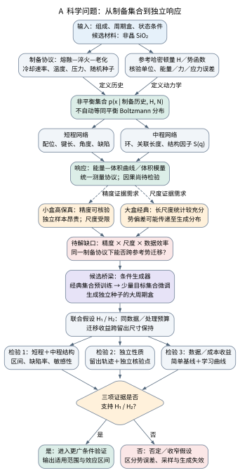
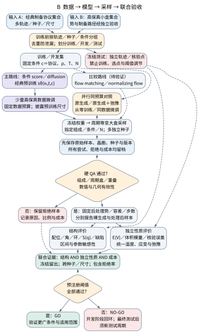
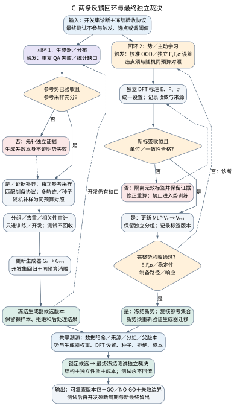

# 从高保真小体系到大尺度非晶系综：科学问题与技术方案

版本：2026-10-22，第二版。本文是拟开展的研究方案，数学基础属于已有理论，尚无本项目的材料科学结论。非晶 SiO₂ 用作具体候选；水或聚合物仍可作为正式对象，材料尚未最终确定。

## 项目摘要

非晶材料的性质由制备历史形成的结构系综决定。经典模拟易积累大规模数据，但参考势偏差会传递到生成模型；高保真计算能改善局部物理描述，却难以直接覆盖大尺度、长时间和多次独立制备。本项目拟研究“经典预训练—少量高保真校正—大体系生成”的概率分布迁移，以非晶SiO₂为候选，在固定制备协议下检验数据效率和尺寸推广。主线采用条件扩散生成器，独立核验参考势，比较从零训练、仅换势后处理与生成器微调，联合评价局域／中程网络及0 K松弛体积模量。项目的候选贡献是识别有限参考信息能改善哪些统计规律、这种改善在哪些尺寸失效，以及生成器与势的反馈更新分别是否有效。预期交付可追溯数据与模型、等预算对照、误差和成本曲线及适用范围；上述收益均需实验验证，不作为既成结论。

## 1. 为什么做：从一个合理结构到可信的结构系综

非晶材料没有一个可以代表全部样品的周期晶胞。同一化学组成下，不同的冷却、退火、压力历史会留下不同的局域连接、环及缺陷分布。以非晶 SiO₂ 为例，Vollmayr、Kob 与 Binder 的模拟已经显示，冷却速率会改变径向分布、键角、配位及环分布，并改变密度、焓和振动谱。因此，需要描述的是**给定制备过程产生的一组结构及其出现概率**。[S1]

这种系综观点与材料计算的用途直接相关。若只优化出一个低能结构，难以判断它是否代表典型样品；若只验证平均径向分布函数（RDF），又可能遗漏不同网络连接方式对响应的影响。我们希望得到一组能计算平均性质、样本间差异和有限尺寸误差的结构。这里的目标是让生成结构能够支持明确的材料性质预测。

困难来自三个相互制约的要求。电子结构方法能提供指定近似下的高保真局部能量和导数，但长时间、大体系制备昂贵；经典势容易积累大规模轨迹，但其势能面和结构偏好可能带有系统偏差；大体系有助于容纳更长的关联和响应模式，但不能自动提高参考物理的准确度。SiO₂ 的机器学习势研究已经讨论了经验势与电子结构来源势之间的联系和差异，为跨参考模型比较提供了具体基础。[S2]

生成模型的价值在于，把已有制备计算中反复出现的统计规律学成可重复采样的分布，尝试降低获得独立候选结构的成本。它不能创造训练参考中不存在的物理信息，也不能凭网络复杂度修复有偏的参考势。本项目真正有价值的结果应是：**用有限的新增高保真信息，在相同资源下改善可用结构系综，且这一改善能通过独立性质检验。**

*图1｜科学问题的因果结构。流程表示建模和验证关系，不代表已经测得的因果效应。局域结构、中程网络和宏观响应必须联合检验。*

## 2. 核心问题与可被推翻的假设

核心问题是：**少量高保真小体系参考数据，能否修正经典数据预训练的生成分布，并使这种修正在更大体系的结构和独立性质中保留下来？**

“高保真”指相对于明示的电子结构参考，而非真实材料的无误差答案。研究中必须分开三个判断：是否更接近某个教师模型、是否提高了材料物理可信度、是否节省了总成本。三者不能相互替代。

| 假设 | 可检验的预测 | 能推翻或限制它的结果 |
|---|---|---|
| H1：经典预训练有助于少数据迁移 | 同样新增参考数据量下，微调比从零训练更准确；优于只更换后处理势 | 优势由额外弛豫完全解释，或与从零训练无差异 |
| H2：小体系校正可部分保持到大体系 | 冻结模型后，在留出尺寸上，网络统计和主要性质仍改善 | 仅训练尺寸有效，或长波与中程统计退化 |
| H3：性质验证能揭示二体统计遗漏的误差 | RDF接近时，不同方法仍可能在网络及松弛体积模量上有可重复差异 | 当前误差范围内未发现差异，则不宣称该机制已证实 |

H3首先是诊断性假设。发现环分布与模量相关，只能说明关联；要主张具体网络特征导致响应变化，还需受控干预或额外物理分析。方案允许假设失败，并要求记录失败发生的尺寸、条件和参考模型。

## 3. 已有工作与本项目可能的贡献

| 原始工作 | 已展示的内容 | 对本项目的约束 |
|---|---|---|
| DM2，npj Computational Materials，2025年在线、2026年卷期 [S3] | 非晶SiO₂和金属玻璃生成、大尺度结构及性质评价 | 非晶生成、大体系、RDF和力学曲线已有先例 |
| Scalable Boltzmann generators，Nature Communications，2026 [S4] | 包括mW冰在内的概率生成与尺寸扩展 | 可作概率及工程对照，不能等同于全原子液态水或玻璃 |
| Equivariant generative diffusion…，2026预印本 [S5] | DFT来源非晶氧化物结构学习，并考察条件与尺寸 | 使用DFT数据生成非晶不能直接称首次；预印本须持续跟踪 |
| MatterGen，Nature，2025 [S6] | 无机晶体条件生成及性质评价 | 可借鉴验证组织，晶体结果不直接证明非晶适用性 |

当前候选贡献是**跨参考势迁移的数据效率、跨尺寸保持的范围，以及结构—性质联合验证所揭示的失效机制**。它不是已确认的新颖性声明。正式立项前还需针对最终材料、条件和方法继续查重；如果强近邻已充分解决这一问题，应调整研究假设。

## 4. 数学对象：势、分布与大体系之间是什么关系

令结构为 $x=(R,h,a)$，包含坐标、晶胞及元素标签，条件 $c$ 包含组成、尺寸、密度与制备协议 $\mathcal P$。本项目有两组不同的参数：势模型参数 $\psi$，生成器参数 $\theta$。

$$
\begin{aligned}
U_\psi(x)&\longrightarrow\{E,F,\sigma\},\\
z\sim\rho,\quad x&=G_\theta(z;c),\quad x\sim q_\theta(x\mid c).
\end{aligned}
$$

势模型给能量、力、应力；生成器把简单随机变量变成结构分布。生成器不一定具有低维潜空间，也不必把机器学习势“编码到潜空间再放大”。扩散模型通常在与结构同维的噪声变量上学习逐步去噪。大体系能力来自表示、周期几何、网络作用范围及训练分布的共同设计，不能仅由解码器可接受更多原子推出。

### 4.1 学习的是哪一种分布

对平衡液体，满足相应条件时可用正则分布 $\pi_U\propto e^{-\beta U}$。对有限速率制备的玻璃，应使用协议条件分布 $p_{U,\mathcal P}$。它由初态和整条动力学路径产生，不只取决于终态的温度或能量。

设 $U^{\mathrm C}$ 为经典参考，$U^{\mathrm H}$ 为通过核验的高保真参考。拟实施的迁移为

$$
\begin{aligned}
q_{\theta_0}(x\mid c)&\approx p_{U^{\mathrm C},\mathcal P}(x\mid c),\\
q_{\theta_*}(x\mid c)&\approx p_{U^{\mathrm H},\mathcal P}(x\mid c).
\end{aligned}
$$

第二个近似是要验证的目标。把经典构型送去做几个DFT单点，只获得该构型上的势能信息，不会自动生成目标势下的出现频率。必须通过目标协议下的参考样本、适用的统计力学关系或明确校准的近似，建立信息与概率之间的联系。

### 4.2 为什么先选择条件扩散

扩散模型对参考结构加噪，再预测所加噪声。在欧氏教学情形中，$x_t=\sqrt{\bar\alpha_t}x_0+\sqrt{1-\bar\alpha_t}\epsilon$，训练损失可写为

$$
\mathcal L_{\mathrm{diff}}(\theta)
=\mathbb E_{x_0,t,\epsilon}
\left[\lambda_t\|\epsilon-\epsilon_\theta(x_t,t,c)\|^2\right].
$$

本方案选它作为首个主线，是因为有可比较的非晶方法和自然的预训练／微调接口；这属于工程判断，不是它在理论上必定最优的证明。周期原子结构必须使用与环面及原子对称性一致的噪声和网络，不能把上述欧氏公式直接照搬到分数坐标再取模。

Flow matching回归速度场、积分ODE生成结构，可作后续成本与精度对照；归一化流在适用时能给出密度和重要性权重，适合概率诊断。它们不必同时训练。先把一种主线与科学对照做清楚，再根据失效证据增加方法。

后半部分的[数学推导](generative_theory.md)逐步说明：路径分布；换元公式与流密度；KL与平衡自由能；DDPM高斯后验与带权噪声回归；flow matching与连续性方程；周期边界及能量引导的范围。这些已有理论不作为本项目创新。

## 5. 为什么用松弛体积模量验证

第一性质候选是**0 K、同一局部稳定分支上的松弛体积模量**，配合能量—体积曲线。结构生成后按同一规则得到局部极小点，对小体积应变重新松弛内部坐标，再拟合响应。它不是有限温度等温模量。

设体积应变 $\eta=(V-V_0)/V_0$，$u$ 为内部非仿射位移。$V_0$ 对应统一指定的压力／密度条件，残余压力为 $P_0=-U_\eta/V_0$，不能把不同残余压力下的曲率混作零压模量。这里固定胞形，仅松弛内部坐标；若允许胞形松弛，需另行定义测量协议。在局部平衡点附近展开势能：

$$
U(u,\eta)\simeq U_0+U_\eta\eta
+\tfrac12 U_{\eta\eta}\eta^2
+\eta\,\Xi^\mathsf T u+\tfrac12u^\mathsf T\mathcal H u.
$$

$\mathcal H$ 是位置Hessian，$\Xi=\partial^2U/\partial u\partial\eta$。内部松弛满足 $\mathcal H u_*=-\Xi\eta$。去除整体平移零模，并要求剩余内部Hessian正定，在这一稳定子空间中代回，得到

$$
K_{\mathrm{rel}}
=\frac1{V_0}
\left(U_{\eta\eta}-\Xi^\mathsf T\mathcal H^+\Xi\right).
$$

第一项是固定仿射变形的曲率，第二项是内部松弛降低的曲率。Hessian的逆涉及集体响应，说明仅凭二体距离统计并不能在数学上确定模量；这给出了增加网络和性质检验的物理理由。[S7] 但这一理由不保证本项目一定发现新的网络机制。

实际评价优先用有限差分能量—体积拟合，检查应变窗口、力收敛和拟合残差。若发生盆地跳变或负曲率，应单列为稳定性事件，不能套用同一光滑分支公式。有限温度模量涉及自由能曲率和涨落，需要另一套采样协议，不得与0 K结果混报。

## 6. 数据、模型、采样和验证的完整流程

*图2｜拟实施的技术流程。训练与评价采用不同的数据角色；原始生成、后处理和拒绝样本分别保留。本图不表示已经完成训练。*

### 6.1 先定义制备与数据角色

固定组成、温度／压力路径、冷却率、等待时间、初态分布和最终投影规则。经典与目标势采用匹配协议；若因稳定性必须改变协议，明确把它作为额外变量。

按独立初态／制备轨迹分组划分训练、开发和最终测试，禁止将同一轨迹相邻帧随机拆到两边。大尺寸最终测试还需独立于所有预训练数据；若经典预训练已经见过大盒，只能称该尺寸上的参考势迁移，不能称完全未见尺寸外推。划分、种子、势文件和哈希先冻结。

### 6.2 验收目标参考，再谈重新训练

优先复用适合最终材料的公开势或专用权重。独立参考点检查能量、力、应力及制备路径覆盖；模型家族名字、通用势标签或训练集规模不能替代验收。若已有势足够，冻结 $\psi$，主要训练生成器 $\theta$。

若势未通过检验，才增加电子结构标签并微调势。MACE类模型可以是候选接口，但通用模型在非晶缺陷、强应变或水氢键环境上的适用性必须实测。目标分布优先依靠目标势下的独立制备样本，而非只给经典构型补单点能量。

### 6.3 训练生成器并保留可解释基线

先复现一个公开非晶设置，确认数据、单位、周期表示和采样实现。主线为：经典预训练 → 目标参考集合微调 → 冻结参数 → 留出条件与尺寸采样。数据量用独立制备单元计数，同时披露帧数和相关性。

几何要求包括整体旋转／平移一致性、同元素置换一致性、周期距离连续性和组成守恒。SiO₂的原子表示可作起点；全原子水还需检验O—H几何、氢键及质子物理范围；聚合物则必须处理链连通、交叉和缠结。它们不只是换一份输入文件的同一问题。

### 6.4 大体系采样不等于复制小盒

检查邻居图、周期映射、网络感受范围和全局条件的尺寸行为，尤其是密度、低波数结构因子及网络连通。局部生成器可能在RDF上通过而在长波或拓扑上失败。周期重复的小盒不能作为独立大体系样本。

每次尝试记录种子、条件和模型版本。原始输出只做事先声明的合法性筛查，失败与拒绝也计入分母。若需要短MD或最小化，冻结时长／阈值，保留处理前后两套数据，防止以延长修整掩盖采样误差。

### 6.5 验证结构、响应和完整成本

局域层检查RDF、配位、角分布、碰撞及缺陷；中程层检查明确定义的环统计、连通和结构因子；性质层检查能量—体积曲线及模量分布。报告均值、离散性和跨种子稳定性，采用轨迹／独立制备单元级统计区间，不把相关帧当独立重复。

独立性分两层：留出轨迹检验对同一参考模型的泛化；未参与训练和调参的电子结构核验检验参考模型误差。主性质为模量时，还需在独立小盒核验受应变的能量—体积／应力响应；单点能量、力与应力误差不能保证二阶曲率精度。若引导、弛豫和最终打分全用同一势，仍缺少后一层证据。实验比较还要匹配制备条件和测量定义。

总成本包含参考数据、训练、生成、失败、后处理和物性评价。已有权重摊销成本与本轮新增成本分开，报告单位合格样本成本和达到给定误差的成本，避免只比较网络一次前向时间。

## 7. 对照实验如何排除简单解释

| 组别 | 数据与处理 | 主要排除的解释 |
|---|---|---|
| B0：目标势参考制备 | 独立轨迹，冻结协议 | 提供同一模型下的结构与性质基准 |
| B1：原生成器 | 原参考与规定后处理 | 复现公开方法能达到的水平 |
| B2：原生成器＋目标势后处理 | 与主线相同后处理预算 | 改进是否仅来自换势弛豫 |
| B3：目标数据从零训练 | 与主线同样的新增高保真数据 | 经典预训练是否提高数据效率 |
| M：经典预训练＋目标微调 | 相同新增数据、测试和后处理 | 核心迁移假设 |
| A：主动选点／随机补样 | 相同新增参考计算预算 | 回环是否比随机补样更划算 |

分阶段改变新增独立数据量，绘制误差—数据量曲线。阈值由先导计算的数值误差、参考方差和研究用途确定，最终测试前锁定，不先承诺固定百分比或未经实测的GPU时数。

H1比较M与B2、B3；H2比较留出尺寸上改进的保持；H3在RDF误差接近时比较网络及响应。所有比较给出样本量与不确定度；区间不能区分方法时如实报告。

## 8. 主动学习需要吗：两条回环分别处理

先冻结一轮基线，通过具体失败决定补什么信息：

*图3｜两条独立反馈回环。生成器学习出现概率，势学习能量及导数；二者可交换诊断信息，但不能以彼此自洽替代独立核验。*

生成器回环针对分布覆盖不足：生成 → 识别可重复的结构／性质缺口 → 补充相应条件下的独立参考制备 → 更新 $\theta$ → 开发集回归。势回环针对势能面误差：经校准的适用域信号或独立误差 → 选参考点 → 电子结构标注 → 更新 $\psi$ → 重新验收，再决定是否重制数据。

模型分歧只是选点信号，需用真实误差校准；模型可能有共同盲区，也可能在无害区域产生分歧。最终测试集不用于每轮选点和调参；回归使用开发集，锁定方案后评价最终留出集。每轮保存数据版本、参考方法、标签成本、模型哈希和选点理由。

只有生成分布不足而势已可靠时，只更新生成器；势本身失效时，更多自评分低能构型不能解决问题。主动选点应与随机补样做等预算比较，有收益后才作为主线贡献。

## 9. 分阶段交付与继续／停止条件

| 阶段 | 具体证据 | 决策 |
|---|---|---|
| P0：基线及缺口 | 公开设置复跑、处理前后样本、冻结评价脚本、误差与成本 | 无可重复缺口则调整问题，不预设失败 |
| P1：参考验收 | 目标势核验、小盒匹配协议数据、分组划分 | 参考不可信则先补参考，暂缓迁移结论 |
| P2：数据效率 | B2/B3/M学习曲线、结构和模量联合结果 | 优势由处理或数据量解释时收窄假设 |
| P3：尺寸扩展 | 冻结模型、多尺寸多种子验证及全成本 | 仅局部统计通过时限制可用范围 |
| P4：反馈消融 | 主动／随机等预算比较、版本记录 | 无额外收益时保留简单路线 |

值得继续的证据是：独立主要性质误差在相同新增预算下下降，高阶结构未退化，跨种子和留出尺寸稳定，计入后处理仍有收益。负面结果可界定方法边界，不能包装为已经发现新材料。

### 9.1 可行性基础与仍缺的条件

已有基础包括：可复用的配置和Slurm入口；真实预训练生成器的CPU采样、结构写出与溯源示例；公开非晶基线、数学推导和独立验证设计。这些降低了软件搭建的不确定性，但尚不能证明目标材料的数据、势精度或训练资源已经具备。

P0必须落实最终材料、上游数据／权重许可及下载可用性；P1必须落实电子结构参考、势的核验和匹配协议数据。P2以后才需要正式生成器训练预算。目前GPU资源繁忙，先做CPU接口检查、基线数据审计和评价流程准备；训练与模拟仍经Slurm运行。DFT队列、软件许可和可用核时需独立确认。本文未实测训练和DFT成本，因此不填未经依据的GPU小时、经费或日历承诺。

采用依赖关系安排进度：P0完成才冻结问题；P1验收才启动P2；P2出现稳定收益再扩展P3；P4由具体误差触发。每一阶段先用小规模试跑测定单样本耗时、数据相关性和方差，再给下一阶段分配资源与重复次数。这样即使GPU排队，数据和验证准备仍能独立推进。

### 9.2 工作包与可检查的交付

| 工作包 | 责任与输入 | 阶段交付 |
|---|---|---|
| WP1：问题与证据 | 文献和科学目标；明确近邻与差异 | 冻结研究假设、材料、条件和最终测试规则 |
| WP2：参考与数据 | 势、电子结构核验、制备协议 | 版本化数据、分组划分、参考验收和成本清单 |
| WP3：生成与工程 | 基线实现、预训练／微调、周期采样 | 配置、模型哈希、原始／处理后样本及拒绝记录 |
| WP4：独立评价 | 留出数据、受应变响应、统计方法 | 结构—性质—成本联合比较与适用域报告 |

多智能体可分别承担检索、实现、推导和复核，生成与评价尽量由不同任务独立检查。智能体分工不等同于物理证据独立；真正的独立性仍取决于数据、参考计算、测试冻结和审计记录。

预期科学交付是：一组可复查的数据效率和跨尺寸对照，支持或否定H1—H3的证据，以及明确的失败边界。预期工程交付是：可复跑的Slurm配置、数据／模型接口、验证脚本和同源HTML/PDF文档。论文贡献应由这些证据决定，不预先以投稿期刊或模型规模定义成功。

### 9.3 主要风险与替代路径

| 风险 | 识别证据 | 应对与收窄范围 |
|---|---|---|
| 目标势参考误差主导 | 独立受应变响应不通过 | 优先修正参考；暂不声称材料精度提升 |
| 高保真与经典分布重叠不足 | 迁移不稳、重要结构子群缺失 | 补目标协议数据，限制到可覆盖条件；不依赖能量差硬重权 |
| 小盒不能代表大盒网络 | 留出尺寸的低波数或响应退化 | 分析作用范围和有限尺寸，限制规模声明 |
| 后处理抹平方法差异 | B2与M表现相当 | 记录为迁移假设未获支持，保留更简单可用路线 |
| 资源或独立样本不足 | 排队、强相关、区间过宽 | 先完成工程与数值收敛，减少同时变化的条件，不以相关帧补数 |

正式申报版还需补齐已选材料、已有相关研究成果、可用算力／经费及有依据的时间表。本稿定位为可执行的内部项目书初稿，不能把待落实条件表述为已承诺资源。

## 10. 当前完成了什么

| 类型 | 当前状态 | 可以支持的判断 |
|---|---|---|
| 文献事实 | 原始论文和官方代码调研 | 已有能力及拟研究空缺的初步界定 |
| 工程执行 | bgmat真实CPU采样：8个216粒子mW冰构型，见[生成示例](real_generation_results.md) | 预训练模型、调度、采样、写出和溯源可以衔接 |
| 数学基础 | 本文与后附推导 | 说明目标、损失、采样和验证；不是新理论 |
| 拟研究 | 非晶迁移、体积模量、跨尺寸、主动回环 | 尚未训练或取得材料结论，需按P0—P4验证 |

首个正式决策仍是材料和参考模型。SiO₂候选有清楚的网络结构与公开近邻；水延续前期兴趣，但必须区分液态水、非晶冰和mW单珠冰；聚合物还需解决链拓扑和时间尺度。路线可以迁移，科学验收必须随对象重定。

## 11. 原始来源与继续阅读

[S1] Vollmayr, K., Kob, W. & Binder, K. *Cooling-rate effects in amorphous silica: A computer-simulation study*. Physical Review B **54**, 15808 (1996). [出版页](https://doi.org/10.1103/PhysRevB.54.15808)。用于制备历史、网络和性质的关系。

[S2] Erhard, L. C., Rohrer, J., Albe, K. & Deringer, V. L. *A machine-learned interatomic potential for silica and its relation to empirical models*. npj Computational Materials **8**, 90 (2022). [出版页](https://doi.org/10.1038/s41524-022-00768-w)。用于参考势背景，不表示本项目已验收该势。

[S3] DM2. npj Computational Materials **12**, 29 (2026)，2025年在线。[论文](https://doi.org/10.1038/s41524-025-01901-1)；[官方代码](https://github.com/digital-synthesis-lab/DM2)。数据和后处理细节见[文献调研](literature_survey.md)。

[S4] Schebek, M., Noé, F. & Rogal, J. *Scalable Boltzmann generators for equilibrium sampling of large-scale materials*. Nature Communications **17**, 5010 (2026). [论文](https://doi.org/10.1038/s41467-026-73900-9)；[bgmat代码](https://github.com/maxschebek/bgmat)。本地示例限制见[执行记录](real_generation_results.md)。

[S5] Jiang, J., Berry, I., Fry, J. N. & Cheng, H.-P. *Equivariant generative diffusion learns and generalizes the structural ensemble of amorphous oxides*，2026预印本。[arXiv:2610.03973](https://arxiv.org/abs/2610.03973)。规模证据需持续核对，不能混同计时演示与完整结构验证。

[S6] *MatterGen: a generative model for inorganic materials design*. Nature (2025). [论文](https://doi.org/10.1038/s41586-025-08628-5)；[官方代码](https://github.com/microsoft/mattergen)。

[S7] Lemaître, A. & Maloney, C. *Sum rules for the quasi-static and visco-elastic response of disordered solids at zero temperature*. Journal of Statistical Physics **123** (2006). [作者预印本](https://arxiv.org/abs/cond-mat/0410592)；[出版DOI](https://doi.org/10.1007/s10955-005-9015-5)。用于非仿射响应理论。

学习入口：[生成理论推导](generative_theory.md)、[技术路线](technical_roadmap.md)、[GitHub文档案例与采用方式](documentation_patterns.md)。PDF将方案和理论合并；HTML拆成相互链接的章节，便于按需阅读。
